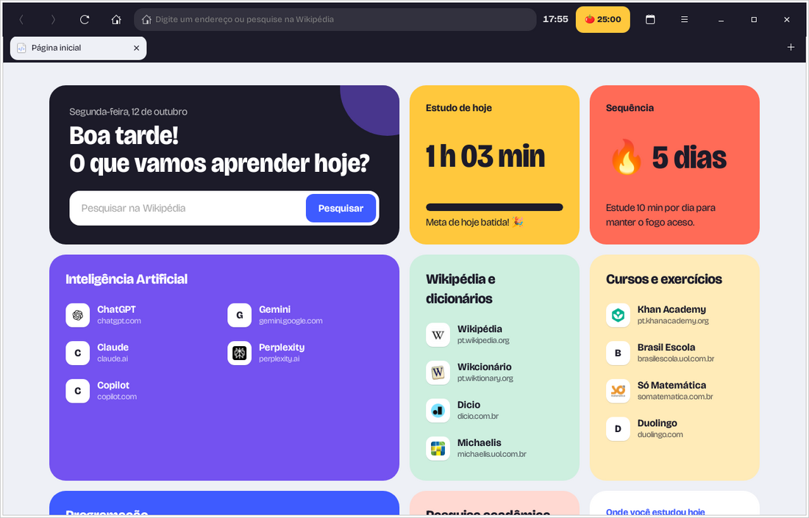
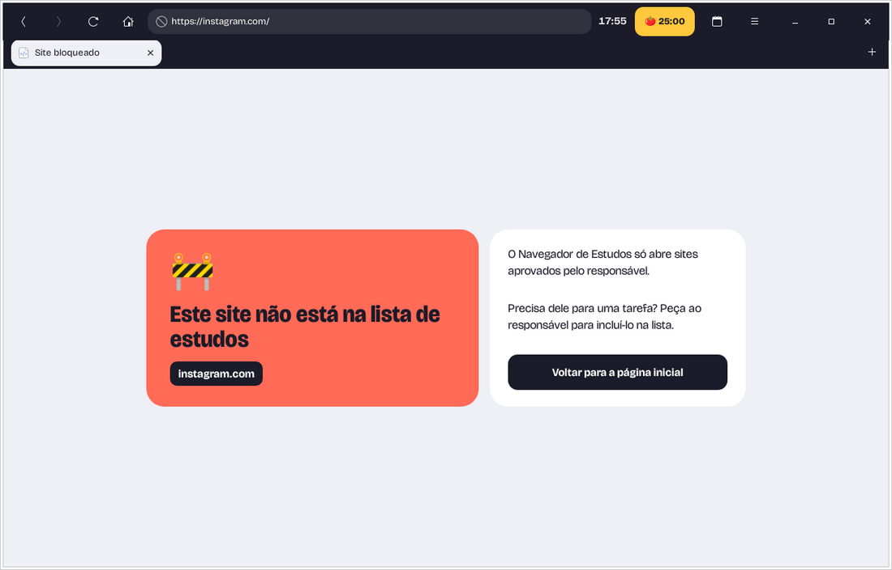

# 📚 Navegador de Estudos

**Um navegador para Ubuntu que só abre sites de estudo.**
Redes sociais, jogos e o resto da internet ficam bloqueados, e a lista de
sites aprovados é controlada por um responsável.



## Para quem é

- 👨‍👩‍👧 **Famílias e escolas** que querem que o aluno use o computador só para estudar.
- 🎯 **Quem quer foco**: um navegador sem distrações para estudar ou trabalhar.

## O que ele faz

| | |
|---|---|
| 🛡️ **Só sites aprovados** | Wikipédia, Khan Academy, IAs (ChatGPT, Gemini, Claude…), documentação de programação e outros. O resto mostra uma tela de bloqueio. |
| 🍅 **Pomodoro** | 25 minutos de foco e 5 de pausa, com aviso. |
| 📊 **Tempo de estudo** | Tempo em cada site, meta diária e sequência de dias. Pausa sozinho quando a pessoa sai do computador. |
| 🔒 **Controle do responsável** | Só quem tem a senha muda a lista de sites. |
| 👤 **Conta de aluno** (opcional) | No modo protegido, a conta do aluno só consegue usar este navegador. |



## Instalar com um comando

Precisa de **Ubuntu 24.04**. Abra o Terminal (**Ctrl+Alt+T**), cole a linha
abaixo e aperte **Enter**:

```bash
sudo apt install -y git && git clone https://github.com/dssxz120-cyber/navegador-estudos.git ~/navegador-estudos && bash ~/navegador-estudos/instalar.sh
```

O instalador confere o sistema, mostra os pacotes que faltam (e pede
confirmação antes de instalar) e pergunta como o navegador vai ser usado:

- **Simples**: uma pessoa usando o próprio computador. A lista fica protegida
  por uma senha do navegador.
- **Protegido**: cria uma conta **aluno** em que só o navegador funciona
  (outros navegadores, terminal e jogos ficam bloqueados para ela). Mudar a
  lista pede a senha de administrador do Ubuntu. A sua conta continua normal.

> 💡 Quer ver antes o que ele vai fazer? Rode com `--simular`: ele mostra
> cada passo sem mudar nada.

## Como usar

1. Abra **Navegador de Estudos** no menu de aplicativos.
2. Clique num atalho da página inicial ou pesquise na Wikipédia.
3. Para começar um Pomodoro, clique no 🍅 no alto da janela.
4. Para liberar ou bloquear sites: **☰ → Área do responsável**.

## Perguntas frequentes

**Como libero um site novo?**
☰ → Área do responsável → acrescente uma linha `Nome | https://site.com/` → Salvar.
Os outros formatos de linha estão no [manual](docs/MANUAL.md).

**Esqueci a senha do responsável.**
Veja [Recuperar a senha](docs/MANUAL.md#recuperar-a-senha) no manual.

**Funciona no Windows ou no Mac?**
Não. Só no Ubuntu 24.04.

**O aluno consegue usar outro navegador?**
No modo **simples**, sim: o bloqueio vale só dentro deste navegador. No modo
**protegido**, não: na conta do aluno, os outros navegadores ficam bloqueados.

**Como atualizo?**
`cd ~/navegador-estudos && git pull`. No modo protegido, rode depois
`sudo bash scripts/isolamento/etapa2-aplicar.sh`.

**Como desinstalo?**
- Modo simples: `bash ~/navegador-estudos/scripts/desinstalar.sh`
- Modo protegido: rode os scripts de reversão em `scripts/isolamento/`, nesta
  ordem: `etapa5`, `etapa3`, `etapa2` e `etapa1` (cada um com `sudo bash …-reverter.sh`).

## Limitações

- **Spotify** abre, mas pode não tocar música (o navegador não tem a proteção de
  conteúdo que ele exige).
- Num computador com **Windows instalado junto** (dual boot), o aluno pode
  iniciar o Windows, que não tem estes bloqueios.
- No modo protegido, alguém com conhecimento técnico ainda consegue burlar o
  bloqueio usando o Python, que o próprio navegador precisa.

## Documentação

- 📖 [Manual completo](docs/MANUAL.md): lista de sites, senha, segurança, dados
- 🧑‍💻 [Guia do código](docs/GUIA-DO-CODIGO.md): como o programa funciona por dentro
- 🔐 [Isolamento da conta do aluno](docs/PLANO-ISOLAMENTO.md): o que o modo protegido faz no sistema

## Para quem programa

Python 3, GTK 3 e WebKitGTK. Para rodar os testes:

```bash
python3 -m unittest discover testes
```

## Licença

[MIT](LICENSE). A fonte Bricolage Grotesque tem licença própria (SIL Open Font License).
